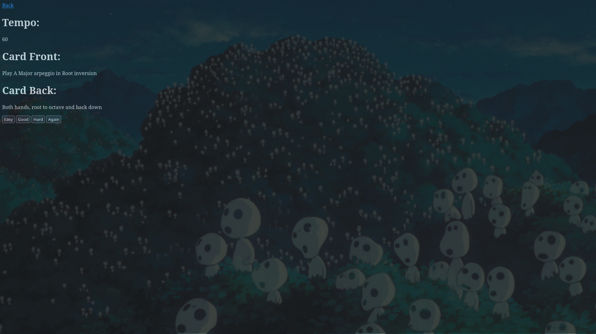

# Musician SRS

A spaced repetition system for music practice.

The main idea is to take the idea of a flashcard SRS and modify it to be useful for instrument-based muscle memory.

An exercise can be put onto a card and placed into a deck, which will continuously feed cards based on their general priority. In addition to normal spaced repetition scheduling, cards can have a tempo and a separate mastery state. This way we can balance short-term scheduling and long-term progression.

This started as a capstone project for Boot.dev which I wanted to actually use.

## Features

- Users, decks, and cards stored in PostgreSQL
- Create, edit, and delete decks and cards
- Study decks with a self-assessment system
- Spaced repetition scheduling using card intervals, ease factors, and total deck review count
- Separate mastery tracking for longer-term practice
- Per-card current and mastered tempos
- Automatic tempo increases as material is mastered
- Tempo reduction after repeated difficulty with a card
- Bulk card generation for common music practice patterns
- Simple HTML / JavaScript frontend
- Go HTTP API

## Screenshots

### Decks


### Study



## Scheduling

There are really two scheduling systems in the project.

The normal SRS scheduler handles which card should come next during practice.

Each deck keeps a total review count. Cards have a target review number and an interval. Instead of short-term scheduling being based directly on wall-clock time, a card becomes due relative to the number of reviews that have happened in the deck.

Active cards are stored in a priority queue. Due cards are preferred, while new cards are introduced when there isn't already an active card due. The scheduler also tries not to give you the exact card you just practiced when another card is available.

These mechanisms allow us to always have a card ready for the user.

Again, Hard, Good, and Easy change the card's interval and ease factor differently.

## Mastery and tempo

The project also tracks longer-term mastery separately from normal SRS scheduling.

Cards use three mastery states:

- `challenge`
- `playable`
- `retained`

Progress through these states is time gated. The current implementation uses an 8 hour wait for moving beyond playable and a 20 hour wait for retained material.

Again can move a card backward in mastery, while Good and Easy can advance it when enough real time has passed.

Tempo is tied into this system as well. Once a card is retained at its current tempo:

- that tempo becomes the mastered tempo
- the current tempo increases by 5 BPM
- mastery starts over for the new tempo

If a card is repeatedly failed while in the challenge stage, its current tempo can drop by 2 BPM without losing the previously mastered tempo.

The current design assumes users will use this 1-2 times per day for 10-15 minutes.

## Bulk card generation

Entering a large number of similar music cards manually gets old very quickly, so the card creation page can generate combinations from templates.

For example, a card using:

```text
Play the {note}{accidental} {mode} scale
```

can generate cards for whichever notes, accidentals, and modes are selected.

Cards without any replacement tags are created normally.

## Backend

The server is written in Go using the standard `net/http` package.

PostgreSQL is used for the database. SQL queries are written separately and the Go database functions are generated by sqlc.

Database schema changes use Goose migrations.

The main backend pieces are split between:

```text
internal/study/       scheduling and mastery logic
internal/database/    generated database access
sql/schema/           Goose migrations
sql/queries/          sqlc queries
```

HTTP handlers are split by users, decks, cards, and studying rather than keeping the whole server in `main.go`.

## Frontend

The frontend is currently plain HTML and JavaScript.

There is no frontend framework. The browser talks directly to the Go API using `fetch`.

The UI supports:

- creating a user
- logging in by email
- creating and editing decks
- creating and editing cards
- bulk generating cards
- studying a deck
- viewing the current tempo while practicing

The current login system is identification rather than real authentication. Because of that, the deployed version is kept private rather than exposed directly to the internet.

## Running locally

Requirements:

- Go 1.25.4 or newer
- PostgreSQL
- Goose

Clone the repository:

```bash
git clone https://github.com/jbeardwo/musician-SRS.git
cd musician-SRS
```

Create a PostgreSQL database and user for the application.

Set `DATABASE_URL`:

```bash
export DATABASE_URL='host=localhost port=5432 user=musiciansrs password=YOUR_PASSWORD dbname=musiciansrs sslmode=disable'
```

The server uses port `8080` by default. This can be changed with the `PORT` environment variable.

Install Goose if needed:

```bash
go install github.com/pressly/goose/v3/cmd/goose@latest
```

Run the migrations:

```bash
~/go/bin/goose -dir sql/schema postgres "$DATABASE_URL" up
```

Then start the server:

```bash
go run .
```

Open:

```text
http://localhost:8080
```

Since there is no seeded test data, create a user through the application first.

## My Deployment

The version I am currently using runs on an Ubuntu Server machine at home.

The Go application runs as a `systemd` service with PostgreSQL on the same machine. I access it privately over Tailscale.

There is currently no public demo because the application does not have real authentication yet.

## Current state

The project is usable and is now running with persistent real data instead of the test database setup I used during development.

There are still things I could add, especially around authentication and frontend polish, but the scheduling, mastery, deck/card management, bulk generation, database persistence, and deployment are all working.

For now I am mostly interested in actually using it for music practice and finding problems that show up through real use.
